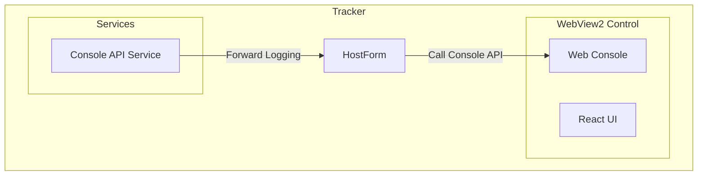
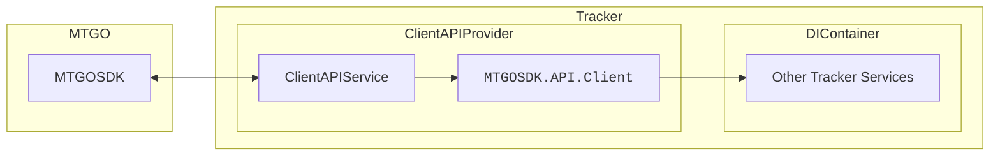
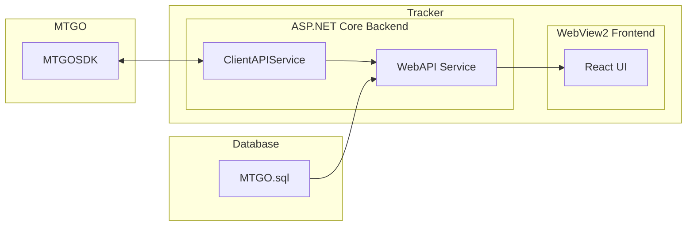
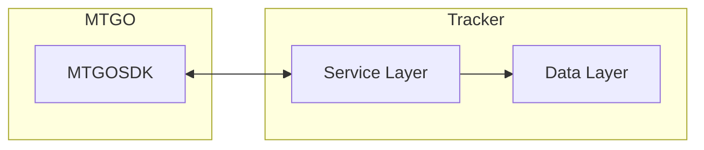
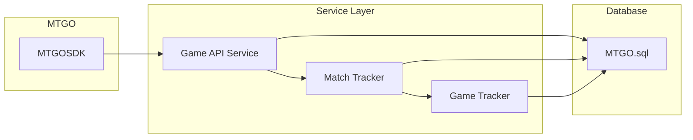
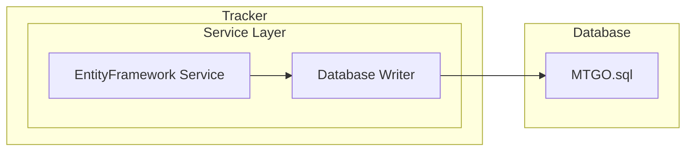
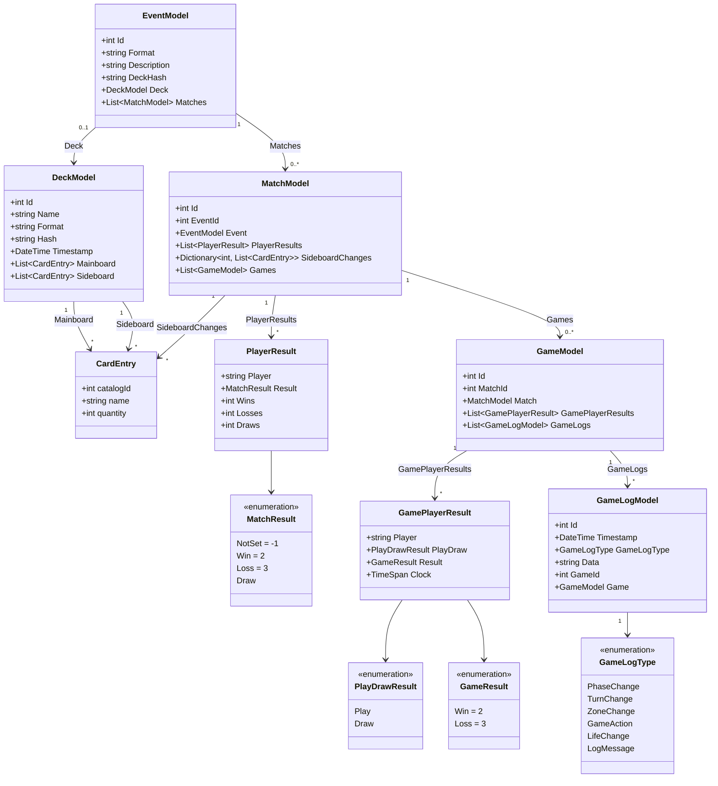
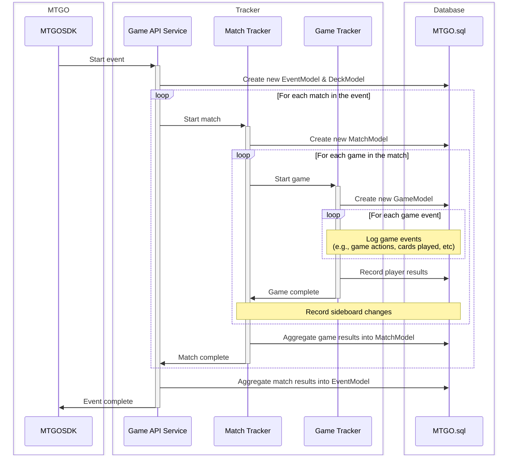
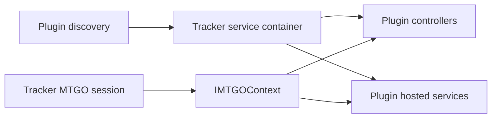

# Videre Tracker Architecture

This document describes the architecture of the Videre Tracker, a real-time data tracking and analytics application for Magic: The Gathering Online (MTGO). It outlines the core components, data processing pipeline, and extensibility features that enable robust gameplay tracking and analysis.

## 1. Overview

The Tracker is built on the .NET platform, leveraging ASP.NET Core for the backend API, Entity Framework Core for data access, and a modern React-based frontend hosted in a WebView2 control. This combination provides a responsive user experience while maintaining robust backend capabilities.

The application architecture follows a layered approach with clear separation of concerns between user interface, application infrastructure, and data tracking layers. This modular design allows for easy maintenance, extensibility, and scalability of tracker services as new features or data sources are added.

----

## 2. Core Application Components

Before describing the game tracking pipeline, it’s important to introduce the core infrastructure of the Tracker: the HostForm/WebView2 component, the ClientAPIProvider/ClientAPIService, and the WebAPI service. These subsystems underpin the user experience, enable robust runtime operations, and provide the integration point between UI, MTGO, and the backend services that populate the database.

### 2.1 HostForm & WebView2 (UI Host and Logging Bridge)

<div align="center">



</div>

The HostForm is the native Windows Forms application window that manages the embedded WebView2 control, providing the bridge between the Tracker's backend and its modern frontend user interface.

- **WebView2 Hosting:** The HostForm instantiates and configures a WebView2 browser control, which renders the Tracker’s React-based UI in a native window frame. This setup allows for a highly dynamic and responsive frontend, allowing the UI to react to native Windows events.
- **C# ↔ JavaScript Interop:** A robust interop layer is provided between C# and JavaScript. HostForm exposes methods for executing JS, and receives events from the WebView2 DevTools Protocol (CDP) to facilitate two-way communication.
- **Console Integration:** All .NET logging is redirected to the in-app frontend console, allowing developers and users to view logs directly in the UI, including logs originating from C# code. This create a central sink for real-time logs and errors for better debugging and monitoring.

This component forms the main interface for interacting with the Tracker, and acts as the anchor point for all user-driven workflows.

### 2.2 ClientAPIService (MTGO Client Connection Management)

<div align="center">


</div>

The ClientAPIService is responsible for the lifecycle management of the Tracker’s connection to the MTGO client using the MTGOSDK library. This subsystem ensures resilience in the face of MTGO crashes, restarts, or connection interruptions, supporting seamless user experience.

- **Connection Management:** The ClientAPIProvider encapsulates all logic required to connect, reconnect, and manage the underlying MTGO process. It registers a provider as a singleton dependency for the application, making the current MTGO client instance available to all dependent services. On process restarts or unexpected crashes, it automatically detects, disposes, and re-initializes without user intervention.
- **Crash Recovery Middleware:** The ClientAPIService injects ASP.NET Core middleware to catch exceptions (such as MTGO process crashes) during API requests. If a crash is detected mid-request, the middleware attempts to transparently re-initialize the MTGO client connection and retry the request, providing high availability.
- **Notification of Dependents:** When connection state changes (e.g., MTGO restarts), all dependent services are notified and can resynchronize their state with the new client instance, allowing features such as real-time event streaming or player state monitoring to recover without application restarts.

This design makes the Tracker robust against instability in the MTGO client, and ensures that backend services and UI components always interact with a valid, current MTGO connection.

### 2.3 WebAPI Service (Backend API for UI and Third-Party Apps)

<div align="center">



</div>

The WebAPI service hosts the Tracker’s backend HTTP API, acting as the primary interface for the frontend UI and any external integrations.

- **ASP.NET Core Web Host:** The application launches an ASP.NET Core server in a background thread, exposing RESTful endpoints for all UI queries and interactions with the Tracker backend.
- **Customizable API Surface:** Endpoints are provided for querying event data, submitting actions, streaming live updates, and more. These APIs are optimized for both traditional request/response and event streaming (NDJSON, Server-Sent Events).
- **Frontend Integration:** The React UI, running inside the WebView2 control, communicates with this backend API for all gameplay data, statistics, and real-time updates. This separation allows for a clean, decoupled architecture and supports future integrations (e.g., plugins, analytics dashboards, external clients).

Together, these core application components provide the backbone for Tracker’s runtime: maintaining a resilient live connection to MTGO, surfacing data to the frontend, handling user interactions, and ensuring that all dependent services operate reliably in the face of client disruptions.

### 2.4 External catalog API

The server build generates its Videre HTTP client and wire models with NSwag from
the API's canonical `https://api.videreproject.com/openapi.json` document.
The downloaded specification and generated C# stay under `obj/Videre` and are not
edited by hand.

The same preparation script generates ignored TypeScript contracts for public
Videre requests. Client development and builds run it before compiling, so
published deck previews consume the API's object arrays and nullable fields.

`VidereAPIClient` applies Tracker's card presentation, catalog reconciliation,
price conversion, and complete-card caching. Requests and response parsing use
the generated client, with one error translation policy for existing controllers.
Collection search uses the documented `CatalogSearchItem` shape for both cards
and products. Its properties reuse the card and product schema definitions.
The generated client's request hook selects the API's cacheable QUERY form for
collection searches and bulk prices, advertised through its `x-query` extension.

----

## 3. Game Tracking and Data Pipeline

This section describes the core tracking and data processing pipeline responsible for capturing, processing, and storing gameplay events.

<div align="center">



</div>

The application is composed of three primary layers that work together to process data from the MTGO client and store it in the database.

* **MTGOSDK Layer (Data Acquisition):** This is the interface with the MTGO client. Using the `MTGOSDK` library, it connects to the client, subscribes to game state notifications (matches, games, actions), and provides the raw data for processing.
* **Service Layer (Data Processing):** This layer contains the core logic of the application. Specialized services transform the raw event data from the SDK into structured models.
* **Data Layer (Data Storage):** This layer is responsible for persisting the processed data. It uses Entity Framework Core to manage the database schema, handle transactions, and ensure data integrity.

### 3.1 MTGOSDK Layer

This layer serves as the interface between the Tracker application and the MTGO client. It leverages the MTGOSDK library to:

- Establish and maintain a connection with the MTGO client
- Subscribe to game events and state changes
- Receive notifications about matches, games, and in-game actions
- Provide access to MTGO's internal object model and state

The SDK layer provides a clean abstraction over the complexity of the MTGO client, allowing our application to focus on data processing rather than the intricacies of interfacing with the client. More details about MTGOSDK can be found in the [MTGOSDK documentation](https://github.com/videre-project/MTGOSDK/blob/main/docs/architecture/README.md).

### 3.2 Service Layer

The service contains specialized components to orchestrate the data flow of events from the MTGOSDK to the database. It is designed to handle the hierarchical nature of MTGO events (where an event can contain multiple matches, games, etc.) and to efficiently process large volumes of data in a structured manner.

<div align="center">



</div>

The service layer is composed of several key components:

* **Game API Service:** Listens for the start and end of a complete event (e.g., a tournament), and manages the overall event tracking lifecycle.
* **Match Tracker:** Tracks player pairings, handles sideboarding between games, and delegates the detailed tracking of each game to the Game Tracker.
* **Game Tracker:** Subscribes to detailed in-game events (e.g., cards played, life total changes), records them as logs, and determines the final outcome of a single game. It uses an efficient producer/consumer pattern to batch-process these events.

Each service is responsible for a specific scope of the game data hierarchy and works together to ensure comprehensive data collection at all levels.

### 3.3 Data Layer

Create a diagram that shows a databasewriter + database service connecting to the database (MTGO.sql) and the service layer.

<div align="center">



</div>

The data layer is responsible for persisting the processed game data into a structured database. It consists of:

- Entity Framework Core context and model definitions
- Database migrations and schema management
- Transaction handling and data integrity enforcement

The data layer uses a relational database schema that mirrors the hierarchical nature of MTGO events, allowing for efficient storage and querying of game data at various levels of granularity.

Below is a simplified class diagram of these database models:

<div align="center">



</div>

The tracker maintains data integrity throughout the system through the use of:

- **Schema Constraints:** Foreign keys and validation rules enforce relationships between events, matches, games, and log entries.
- **Transactional Updates:** All critical updates use transactions to ensure consistency.
- **Hierarchical Validation:** Each layer checks that data is correctly linked and ordered (e.g., games to matches, logs to games).
- **Periodic Checks:** The database automatically schedules jobs to verify data consistency and clean up incomplete records.
- **Audit Trail:** Changes to all tables are logged for traceability and recovery.

These measures are put in place to ensure that the collected data is reliable and accurate for analysis purposes. In case of any issues, the tracker can recover gracefully, either by retrying operations or by reconstructing the state from the last known good snapshot.

----

## 4. Game Event Processing & Lifecycle

This system processes data in a hierarchical sequence, designed to capture events as soon as they occur. To minimize any potential sources of interruption, the tracker uses a producer/consumer pattern, where the MTGOSDK acts as the producer of game events, and the Game API Service, Match Tracker, and Game Tracker act as consumers that process these events asynchronously.

The following diagram illustrates this flow:

<div align="center">



</div>

This begins with the MTGOSDK receiving and forwarding notifications from the MTGO client, which are then processed by the tracker's Game API Service. This service orchestrates the tracking of matches and games, ensuring that all relevant data is captured and stored in the database.

### 4.1 Event Lifecycle

We use these services to create a structured flow that captures the lifecycle of an MTGO event, from the initial game start to the final results being stored in the database. The key steps in this pipeline are:

1.  **Event Start:** The `GameAPIService` detects a new MTGO event, creating an `EventModel` and a corresponding `DeckModel` for the player's registered deck.
2.  **Match Start:** For each match, the service delegates to the `MatchTracker`, which creates a `MatchModel`.
3.  **Game Start:** The `MatchTracker` delegates to the `GameTracker` for each game in the match, which creates a `GameModel`.
4.  **Game Logging:** The `GameTracker` captures every game action and change to game state (e.g., zone changes, spells cast, life total changes) and creates `GameLogModel` entries for each.
5.  **Game End:** The `GameTracker` records the game's outcome.
6.  **Sideboarding:** Between games, the `MatchTracker` records any sideboard changes.
7.  **Match End:** The `MatchTracker` aggregates the results from the games to determine the match winner.
8.  **Event End:** The `GameAPIService` aggregates the results from all matches to finalize the `EventModel`.

### 4.2 Error Handling and Recovery

The Tracker ensures robust error handling and recovery mechanisms to maintain data integrity and minimize disruptions:

- **Connection Recovery:** Automatically reconnects to the MTGO client if the connection drops, with retries and health checks.
- **Transaction Safety:** Database operations are wrapped in transactions to prevent partial writes and ensure atomicity.
- **Event Queueing:** Game events are queued and batch-processed, allowing recovery from temporary failures without data loss.
- **State Validation:** Services validate incoming data and can reconstruct partial states if interrupted.
- **Logging:** Errors are logged for monitoring and troubleshooting.

----

## 5. Data Collection Details

### 5.1 Game Events Captured

The Tracker application captures a wide range of game events to provide comprehensive coverage of gameplay:

- **Phase Changes**: Transitions between game phases (untap, upkeep, draw, etc.)
- **Zone Changes**: Cards moving between zones (library, hand, battlefield, graveyard, etc.)
- **Life Changes**: Updates to player life totals
- **Mana Pool Changes**: Addition and expenditure of mana
- **Stack Actions**: Spells cast, abilities activated, and triggers placed on the stack
- **Card Targets**: Information about what targets were chosen for spells and abilities
- **Combat Actions**: Attackers, blockers, and damage assignment
- **Player Decisions**: Choices made in response to prompts and options

Each of these event types is stored with contextual information such as the turn number, phase, and player index, allowing for detailed reconstruction and analysis of gameplay.

### 5.2 Analytics Available

The dashboard and deck editor's Stats sidebar report:

- Match and game records by saved deck, opposing archetype, and play/draw position.
- Game winrates conditional on a card being observed in hand, in a captured
  opening hand, moving from library to hand, or being cast. Sample counts and
  recording coverage accompany these observations; they do not establish that a
  card caused a win or loss.
- Match-clock averages and performance trends for the selected date range.

Sideboarding recommendations and decision-quality analysis are not implemented.

### 5.3 Deck synchronization

`Collection.db` holds the desired deck revisions and pending operations.
`DeckSyncService` schedules commands through `ClientCommandGateway`, which owns
the MTGO mutation boundary. `CollectionHistoryWriter` links imported decks and
completes pending operations, preserving revision IDs referenced by matches
and saved plans.

A queued import stores its available MTGO name and original deck snapshot before
registration. Retries resolve that name, format, and card composition to the same
native deck, including when linking was interrupted. MTGO's reserved names prevent
another creation while a server ID is pending. Later edits and deletions use the
resolved native ID; their revision history remains attached to the original deck.

----

## 6. Extensibility

### 6.1 Backend plugin host

Tracker loads backend plugins at startup. Plugins register C# services and public
ASP.NET controllers through the `MTGOTracker.Plugins` NuGet package. MTGOSDK supplies
the shared game types, state processors, events, and actions. Tracker's package
adds service registration, plugin configuration, and access to its existing session.

The host implementation lives in
`src/server/src/Services/PluginService.cs`. The public library lives
in `src/plugins/` and depends on MTGOSDK. Plugin authors consume the API as a NuGet package; plugins do not need Tracker's
source or executable.
All public Tracker integration types use the `MTGOTracker.Plugins` namespace.

Build the package with:

```sh
dotnet pack src/plugins -c Release -o packages
```

Tracker references the API project directly so clean, locked restores do not
depend on the content hash of a locally rebuilt NuGet package. External plugins
consume the NuGet package, whose version is defined in `Directory.Packages.props`.
CI packs and uploads the `.nupkg` as a downloadable artifact and verifies that its
API DLL matches the host build. The release workflow publishes that artifact to
NuGet.org using Trusted Publishing before creating the GitHub release. Configure
the NuGet policy and `release` environment as described in
[`docs/plugin-publishing.md`](docs/plugin-publishing.md).
Unpublished MTGOSDK builds need their local feed.



Each immediate subdirectory of the user-data `Plugins` folder may contain a
`plugin.json` manifest:

```json
{
  "id": "example",
  "assembly": "Example.dll",
  "entryPoint": "Example.ExamplePlugin",
  "apiVersion": 1,
  "enabled": true
}
```

`Plugins:Directory` overrides the installation directory. Standard .NET
configuration sources apply, including the `Plugins__Directory` environment
variable. Each plugin receives its own `Plugins:{id}` configuration section and
persistent `PluginData/{id}` storage directory through `PluginContext`.

The public entry point implements `ITrackerPlugin.ConfigureServices`:

```csharp
public sealed class ExamplePlugin : ITrackerPlugin
{
  public void ConfigureServices(IServiceCollection services, PluginContext context)
  {
    services.AddHostedService<ExampleService>();
  }
}
```

- Service registration runs before Tracker builds its service provider.
- Public controllers in the entry assembly are discovered automatically. Their
  relative attribute routes are prefixed with `/api/plugins/{id}`. Absolute
  controller/action routes are rejected.
- Startup, cancellation, shutdown and disposal use the standard .NET
  `IHostedService`, `IDisposable` and `IAsyncDisposable` lifecycles. Configuration
  entry points do not own a second application or service provider.
- Private managed and native dependencies resolve through the plugin's published
  dependency manifest. Framework assemblies, plugin contracts, and MTGOSDK assemblies share the
  host's identity. Other dependencies resolve from the plugin first, including
  libraries that happen to also be used by Tracker. The shared framework list is
  generated from the host's framework references, preserving single-file support.
- Disabled manifests are skipped. `Plugins:Enabled=false` skips all discovery
  and plugin execution. Invalid plugins are reported and skipped. Registrations
  are staged and validated, including MVC routes, before committing to the host.
  Plugins cannot remove or replace host services. Hosted-service startup and
  background execution are contained by an error boundary, so a failed plugin
  does not stop Tracker or healthy plugins. Failures are reported by
  `GET /api/plugins/status`; full exceptions are saved to `PluginData/plugin-errors.log`.
- `GET /api/plugins` lists the loaded plugin IDs and assembly versions.
- Settings → Plugins stages ZIP installs and updates, enabled state, configuration,
  and removals. `PluginManager` owns installation discovery and prepares enabled
  packages with their effective configuration before host construction. It also
  keeps the startup preference snapshot, loaded-plugin identities, and failures
  used by both plugin API controllers. `PluginService` consumes those prepared
  packages and handles assembly loading, service registration, and lifecycle;
  installation and settings code has no dependency on the loader.
  `SettingsService` owns the persisted plugin-preference type and atomically writes
  application and plugin preferences in the data root's `settings.json`
  while preserving other sections. Unreadable preferences skip plugins, preserve the
  file, and surface an error in Settings. Schema defaults and saved values are overlaid
  by host configuration. Removal retains `PluginData/{id}`.
- Plugins load once per process. Installation, removal, and enablement changes
  require a Tracker restart. In-process plugins run with the host's permissions;
  dependency isolation is not a security sandbox.

Publish plugins with `EnableDynamicLoading=true` and retain their dependencies,
`.deps.json`, native runtime files and manifest together. Plugins can depend on
Tracker's supported ASP.NET Core and Windows desktop frameworks. Tracker retains
those desktop assemblies when publishing because plugins can use types that are
absent from Tracker's own static references.

### Application updates

`UpdateService` reads the GitHub latest-release endpoint by default. The optional
`Updates:FeedUrl` configuration key accepts a local feed with the same JSON shape.
Both sources use the same staging and activation code. GitHub sanitizes spaces in
asset filenames; downloads are stored locally as `Videre Tracker.exe`. One client
provider owns status polling and detects the handoff to the installed version.

Downloaded executables and their staged receipt live under `Updates` in the
user-data directory. `UpdateInstaller` runs through the new executable's early
`--install-update` entry point, before UI or SDK attachment. It verifies its
compiled version against the release, installs the extracted payload beside the
old version, and signals readiness before the old host shuts down. The helper
waits for that host to exit before launching the installed executable. The UI
thread waits for host shutdown, allowing hosted-service cleanup to finish.

Activation requires the MTGO process to be absent; connection readiness is not
used as a substitute. The helper checks again before launching. Scheduling an
installation after MTGO exits is persisted in the staged receipt. No Diver
compatibility is inferred from package versions. Prior binaries are retained,
but incompatible database migrations do not have automatic rollback.

### 6.2 MTGO capability

Plugins that need the session Tracker owns request `IMTGOContext` from the same
`MTGOTracker.Plugins` package through dependency injection:

- `Client` is Tracker's ready client, or null while disconnected.
- `UserId` is the ready session's cached user identity, avoiding another remote
  query when a plugin checks whether a player can act.
- `Games` provides the exact game wrapper instances used by recording, after
  their processors are initialized. A new wrapper for the same game ID would
  create a different processing scope.
- `Changed` notifies subscribers about connection and game-list changes. Subscribe
  before reading the current list; unsubscribe during service disposal.

The context exposes SDK objects directly. Plugins can read existing processors
and subscribe to SDK events. They must remove only their own subscriptions and
must not dispose the borrowed client, clear game events, or replace recording
processors. Tracker clears the published game list during connection recovery.
Notification failures are logged and isolated from other context subscribers.
MTGOSDK-dependent plugins must build against the SDK package version used by the
host; the loader checks `.deps.json` before activation because SDK assembly
versions alone do not identify package releases. API generation 1 keeps assembly
version `1.0.0.0` across compatible API package releases. Breaking changes require
a new assembly major and manifest generation; older compatible packages remain
supported on newer hosts with the same SDK. Newer packages may require newer hosts.

Tracker owns the MTGO connection, game processing, recording, and HTTP server.
Plugins consume the initialized games and their existing captured state. Plugin
installation, configuration, and behavior belong in each plugin's documentation.

This initial implementation supports backend extensions. Runtime React bundles,
UI page registration, and hot unloading are not implemented.
